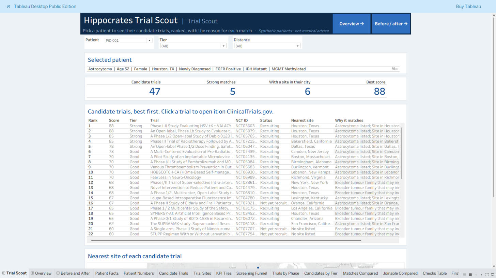
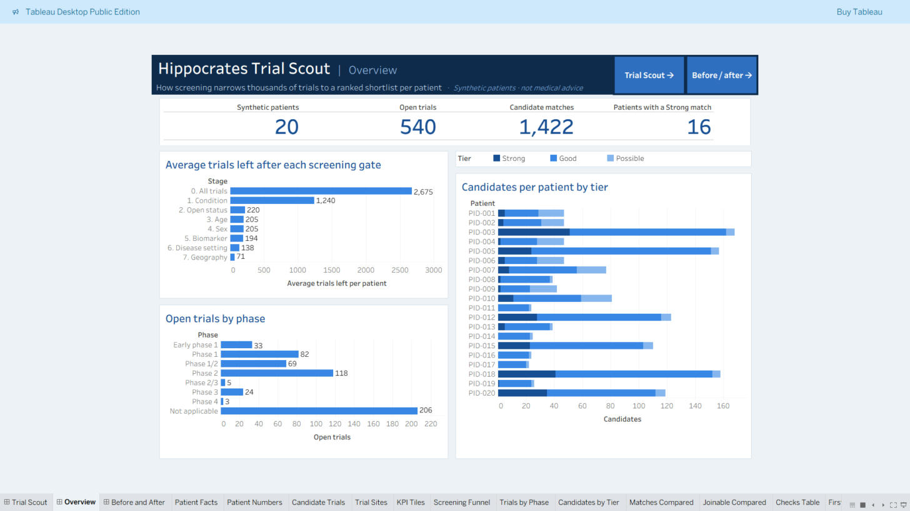
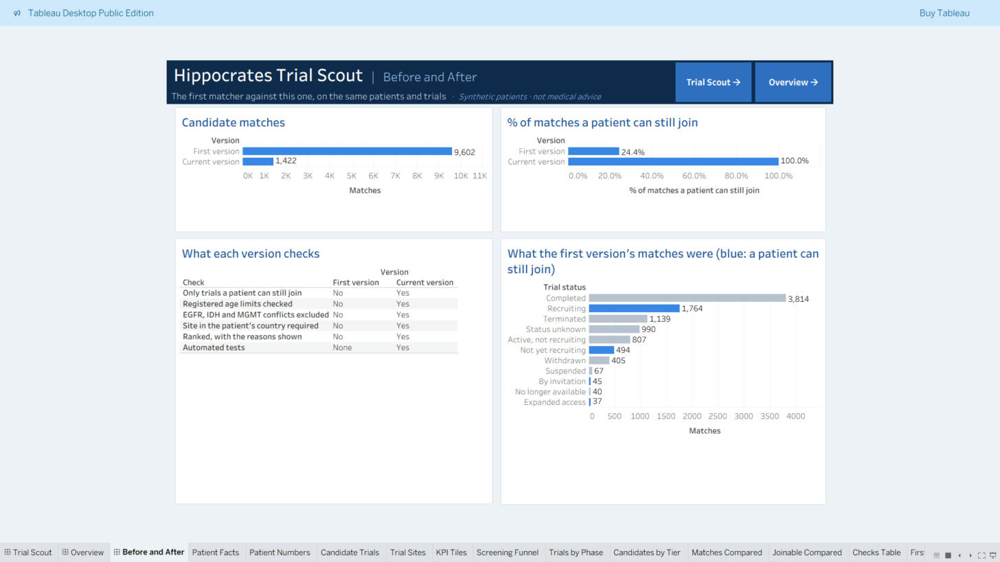

# Hippocrates Analytics: Clinical Trial Matching

Hippocrates screens brain tumour patients against public ClinicalTrials.gov records and gives a clinician a short, ranked list of trials to review, with the reason for each match.

**Live dashboards on Tableau Public:** [Trial Scout](https://public.tableau.com/app/profile/deepti.singh.kushwaha/viz/HippocratesTrialScout/TrialScout) · [Overview](https://public.tableau.com/app/profile/deepti.singh.kushwaha/viz/HippocratesTrialScout/Overview) · [Before and After](https://public.tableau.com/app/profile/deepti.singh.kushwaha/viz/HippocratesTrialScout/BeforeandAfter)

> **Demonstration project.** All patients are synthetic, and `AI_Predicted_Condition` is randomly generated: no imaging model is included. A match is a candidate for clinician review, not a finding of eligibility or a treatment recommendation. The rules have not been validated against clinician decisions.

## Results

From a ClinicalTrials.gov download of 2,675 glioblastoma, astrocytoma and meningioma studies, updated to 2026-10-30, of which 540 are open, for 20 synthetic patients:

| Measure | First version | Current version |
|---|---|---|
| Matches | 9,602 | 1,422 |
| Trials a patient could still join | 24.4% | 100% |
| Registered age limits checked | No | Yes |
| EGFR, IDH and MGMT conflicts excluded | No | Yes |
| Site in the patient's country required | No | Yes |
| Ranked, with reasons | No | Yes |
| Automated tests | 0 | 157 |

Both columns screen the same patients against the same data. 247 matches rate Strong, and 16 of the 20 patients have at least one. Every patient has between 22 and 168 candidates. The current version also finds 660 candidates the first version missed, mainly because the old EGFR rule hid every trial that didn't mention EGFR from EGFR-positive patients.

## Quick start

Requires Python 3.10 or later.

```bash
pip install -r requirements.txt
```

```bash
python -m hippocrates run
```

Then open `dashboard/index.html` in a browser. It is one self-contained file with three views: **Trial Scout**, **Overview** and **Method**.

Output is reproducible: the same inputs and seed give identical files.

| Command | Purpose |
|---|---|
| `python -m hippocrates run` | Clean, generate patients, match, and build the dashboard |
| `python -m hippocrates clean` | Clean the raw trial export |
| `python -m hippocrates patients --count 20 --seed 42` | Generate synthetic patients |
| `python -m hippocrates match` | Match patients to trials |
| `python -m hippocrates dashboard` | Rebuild the dashboard |
| `python -m hippocrates fetch` | Download current studies, including full eligibility criteria |

## How matching works

A trial must pass every gate, in order. Each exclusion is counted per patient in `match_funnel.csv`.

| Gate | A trial passes when |
|---|---|
| Condition | The patient's tumour, or a broader family that includes it, is listed. Synonyms such as GBM and gliosarcoma count. |
| Status | It is recruiting, not yet recruiting, by invitation, or available as expanded access. |
| Age | The patient is inside the registered age range and any limit stated in the summary. |
| Sex | The patient fits any sex restriction. |
| Biomarker | EGFR, IDH and MGMT status do not conflict with what the trial selects for. Untested markers never exclude. |
| Disease setting | Newly diagnosed or recurrent trials take only matching patients. |
| Geography | It has a site in the patient's country, or lists no sites yet. |

Passing trials are scored out of 100:

| Dimension | Points |
|---|---|
| Condition | 35 exact, 18 broader family |
| Geography | 25 same city, 18 same state, 10 same country, 5 no site listed |
| Biomarker | 20 specific fit, 8 neutral |
| Recruitment status | 5 to 10 |
| Disease setting | 5 specified and matching, 2 otherwise |
| Study design | 5 interventional, 2 otherwise |

Records not updated for over two years lose 5 points. Strong is 75 or more, Good is 55 to 74, and Possible is below 55. All of these values are in [config.py](hippocrates/config.py).

## Limitations

- **Eligibility criteria:** inclusion criteria add a biomarker or disease-setting rule only when one clause states it plainly, so unclear wording leaves a trial open for review. Exclusion criteria are not assessed.
- **Free text:** these rules can still miss or misread a requirement. For example, NCT03175224 is treated as EGFR-selected because it lists "EGFR Gene Mutation" as a condition.
- **Distance:** sites are grouped by city, state and country, not measured.
- **Not assessed:** performance status, prior treatment, tumour volume, organ function and comorbidities.
- **Data age:** statuses are only as current as the last `fetch`.

## Updating the data

```bash
python -m hippocrates fetch
```

```bash
python -m hippocrates run
```

`fetch` writes `data/raw/ctgov_api_studies.csv`, with full inclusion criteria, exact age limits and open sites where the API reports them. `clean` prefers that file. Delete it to go back to the smaller 2025 CSV export, `glioblastoma_search_results.csv`, which has none of those.

Clinical trial data comes from [ClinicalTrials.gov](https://clinicaltrials.gov/), through the [API v2](https://clinicaltrials.gov/data-api/api).

## Project structure

```text
├── hippocrates/
│   ├── config.py                  # Paths, taxonomy, scoring and tiers
│   ├── parsing.py                 # Age, site, biomarker and setting extraction
│   ├── clean.py                   # Raw export to trial table
│   ├── patients.py                # Seeded synthetic patients
│   ├── matching.py                # Gates, scoring and ranking
│   ├── fetch.py                   # ClinicalTrials.gov API client
│   ├── dashboard.py               # Builds the HTML dashboard
│   ├── tableau.py                 # Builds the Tableau workbook and extracts
│   └── dashboard_template.html
├── data/
│   ├── raw/                       # ClinicalTrials.gov download and 2025 export
│   └── processed/                 # Generated tables
├── dashboard/index.html           # Generated HTML dashboard
├── tableau/                       # Generated Tableau workbook and extracts
├── docs/
│   ├── DATA_DICTIONARY.md
│   ├── TABLEAU.md
│   └── POWERBI.md
├── powerbi/                       # Original Power BI report
└── tests/
```

Run the tests with:

```bash
pip install -r requirements-dev.txt
```

```bash
pytest
```

## Tableau

`python -m hippocrates run` also writes a Tableau Public workbook to `tableau/`, with its data as `.hyper` extracts. It has three dashboards:

- **Trial Scout** shows the selected patient's headline numbers, then ranks their candidate trials with the reasons for each. It has Tier and Distance filters, links to ClinicalTrials.gov, and a map of trial sites.
- **Overview** shows headline numbers, the screening funnel, open trials by phase, and candidates per patient.
- **Before and After** compares the first version with this one, including what the first version's matches actually were.



 See [docs/TABLEAU.md](docs/TABLEAU.md).

## Power BI

The original report is in `powerbi/`. It is not updated for this version: see [docs/POWERBI.md](docs/POWERBI.md) for the changes it needs.
